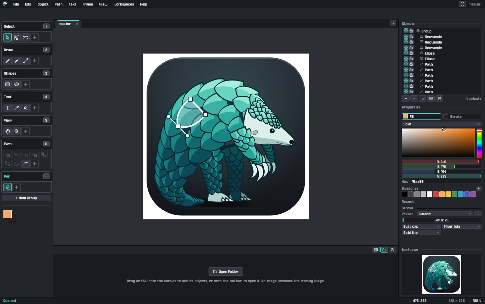
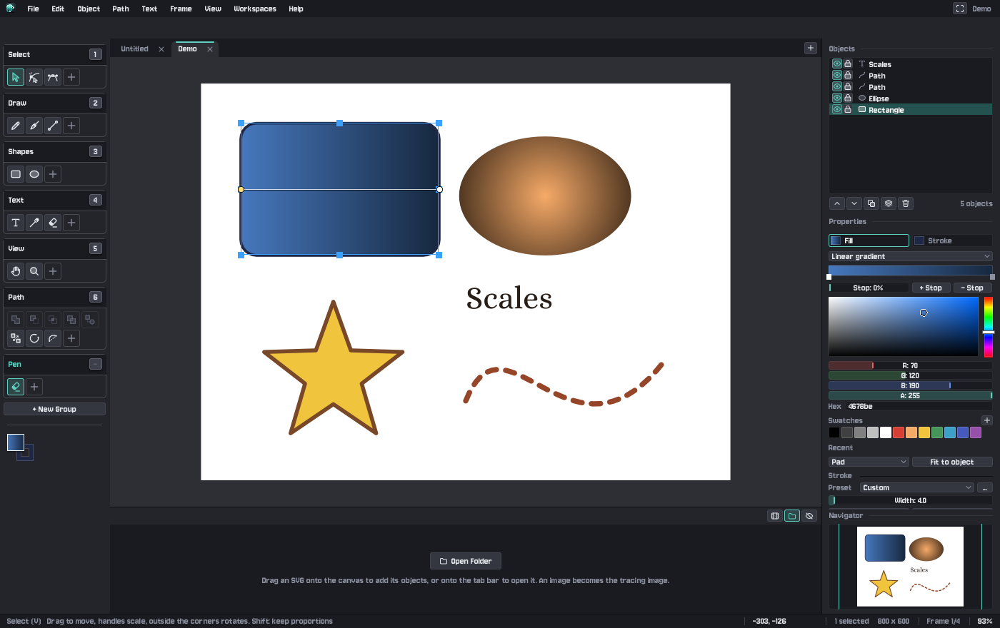
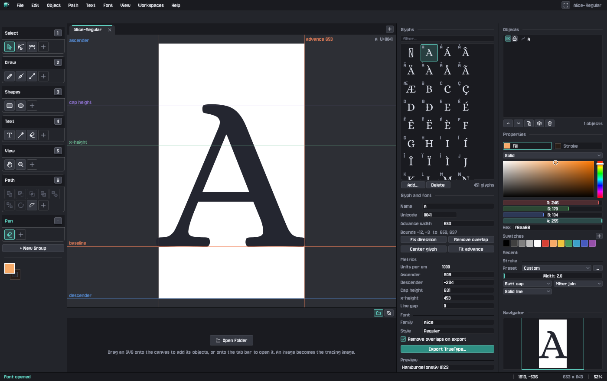

  

<h1 align="center">Pangolin Scales</h1>

<em>Curves, scale by scale.</em>

  A vector drawing and font editor: draw clean, scalable illustrations as SVG and design your own fonts. 
  Free and open source, for Windows, macOS and Linux.

  <a href="https://github.com/BrandonHilde/PangolinScales/releases"><strong>Download the beta</strong></a>
  ·
  <a href="GUIDE.md">Guide</a>
  ·
  <a href="DEVELOPING.md">For developers</a>

## Download

**Version 0.9.0-beta.** This is a beta: it's ready to use, and we'd love to hear what goes wrong.

| Your computer | Download |
|---|---|
| **Windows** 10 or 11 | [PangolinScales-0.9.0-beta-windows.zip](https://github.com/BrandonHilde/PangolinScales/releases/download/v0.9.0-beta/PangolinScales-0.9.0-beta-windows.zip) |
| **macOS** 11 or later, Apple silicon (M1 or newer) | [PangolinScales-0.9.0-beta-macos.zip](https://github.com/BrandonHilde/PangolinScales/releases/download/v0.9.0-beta/PangolinScales-0.9.0-beta-macos.zip) |
| **Linux**, 64-bit (Ubuntu 22.04, Fedora 36, Debian 12 or newer) | [PangolinScales-0.9.0-beta-linux.tar.gz](https://github.com/BrandonHilde/PangolinScales/releases/download/v0.9.0-beta/PangolinScales-0.9.0-beta-linux.tar.gz) |

All versions are on the [releases page](https://github.com/BrandonHilde/PangolinScales/releases).

### Getting started

1. **Unzip** the download anywhere you like. Nothing needs installing.
2. **Open** `PangolinScales.exe` (Windows), `Pangolin Scales.app` (macOS) or `PangolinScales` (Linux).
3. **The first time only**, your computer may want to check with you, because the beta isn't signed yet:
   - **Windows:** "Windows protected your PC". Click **More info**, then **Run anyway**.
   - **macOS:** it says the app can't be opened. Go to **System Settings > Privacy & Security** and click
     **Open Anyway**. On macOS 14 or earlier, right-click the app and choose **Open**.

Each download has an `INSTALL.txt` with the details, including where your settings are kept.

## What you can do

- **Draw shapes and curves** with a pen tool, freehand drawing that turns your strokes into smooth curves, rectangles,
  ellipses, lines and text. Every point and curve stays editable.
- **Reshape things naturally.** The Sculpt brush pushes edges around like clay, the eraser cuts parts of shapes away,
  and Extend carries on drawing from the end of a line.
- **Combine shapes** with union, subtract, intersect and exclude, and simplify, offset or outline paths.
- **Style it** with solid colors and linear or radial gradients, strokes with dashes, rounded corners and opacity.
- **Design fonts.** Open a `.ttf` or `.otf`, or start a new one, and draw each letter with the same tools, with
  guides for the baseline, x-height and cap height. Then export a TrueType font you can install.
- **Animate** an SVG frame by frame, with onion skin and playback, and export animated GIFs or PNG sequences.
- **Trace** over a photo or sketch placed under your drawing.
- **Draw with a tablet.** Pen pressure and the eraser end work with Wacom, Huion and similar tablets.
- **Open and save SVG** that other apps understand, and export PNG at any size.

Every control tells you what it does when you rest the pointer on it, and **F1** lists all the shortcuts. The
[full guide](GUIDE.md) covers everything in detail.

## The Pangolin family

Three editors with the same look and feel, so what you learn in one carries over to the others.

| | | |
|---|---|---|
|  | **[Pangolin Pixels](https://github.com/BrandonHilde/PangolinPixels)**: pixel art and sprite animation | [Download](https://github.com/BrandonHilde/PangolinPixels/releases) |
|  | **[Pangolin Paints](https://github.com/BrandonHilde/PangolinPaints)**: painting, oil paint and photo editing | [Download](https://github.com/BrandonHilde/PangolinPaints/releases) |
|  | **[Pangolin Scales](https://github.com/BrandonHilde/PangolinScales)**: vector drawings (SVG) and fonts | [Download](https://github.com/BrandonHilde/PangolinScales/releases) |

## Found a problem? Have an idea?

[Open an issue](https://github.com/BrandonHilde/PangolinScales/issues). Please say which computer you're on and the
version from **Help > About**. A screenshot helps a lot.

## For developers

Pangolin Scales is written in [Odin](https://odin-lang.org) with SDL3. [DEVELOPING.md](DEVELOPING.md) covers building
it, running the tests, and how the release builds are made.

## License

BSD 3-Clause. See [LICENSE](LICENSE).
